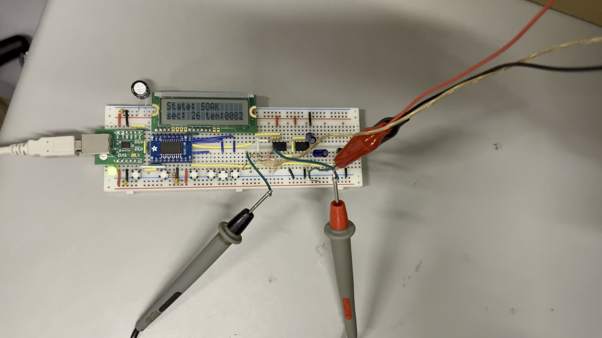
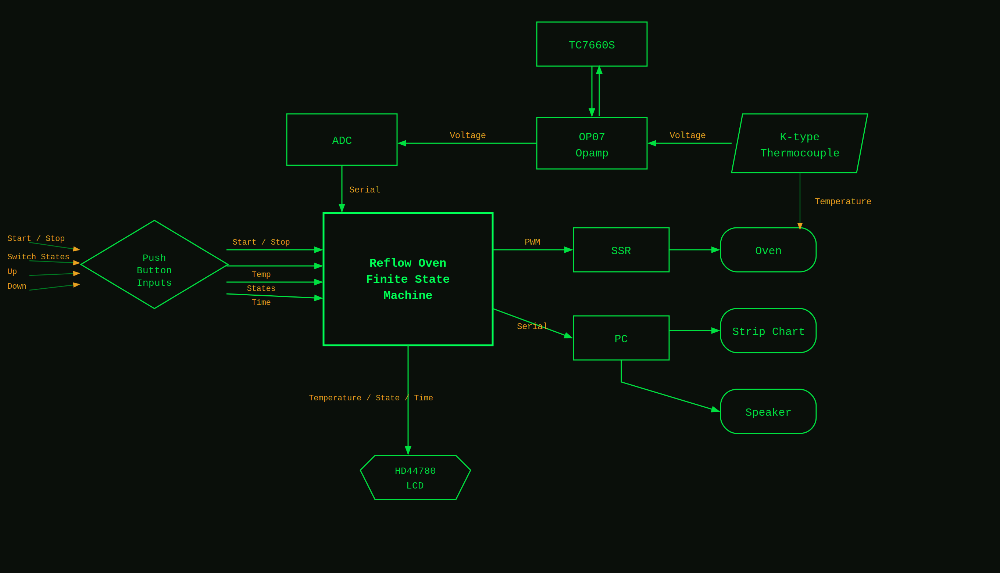
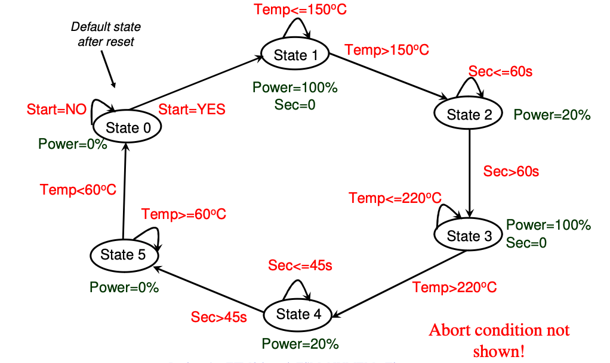
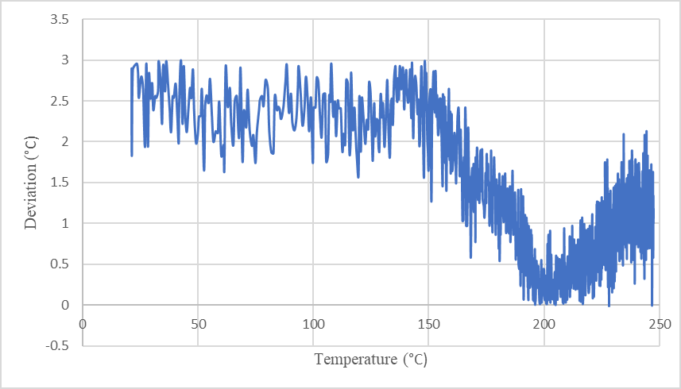
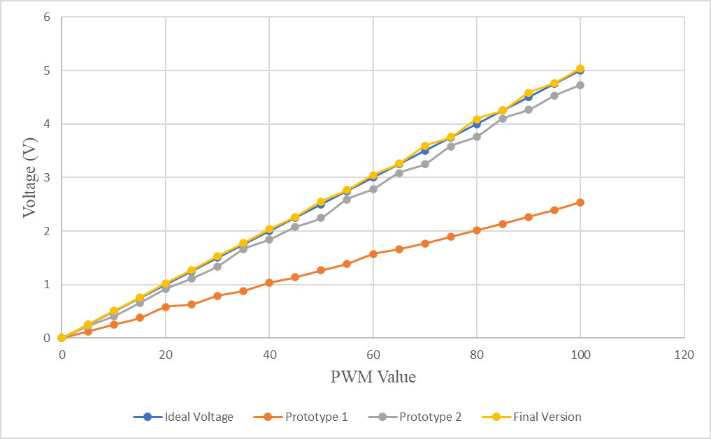
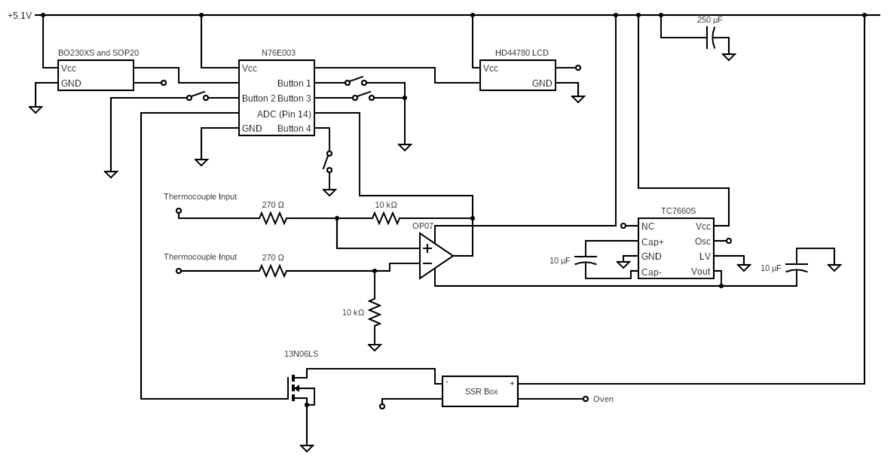

# Reflow Oven Controller

<p align="center"></p>

Soldering a circuit board in an oven takes a carefully timed heat profile. My team of seven and I built the controller that runs one, for ELEC 291 at UBC (January to February 2024). It's written entirely in 8051 assembly for a Nuvoton N76E003 microcontroller.

**Full write-up:** [plundis.github.io/#proj/reflow-oven-controller](https://plundis.github.io/#proj/reflow-oven-controller)

## What it does

- Runs an oven through a full reflow profile: heat to soak, soak, heat to reflow, reflow, then cool down
- Lets you set the soak and reflow temperatures and times with pushbuttons before you start
- Shows the current stage, the time and the temperature on an LCD
- Sends the temperature over serial so a PC can plot it live
- Stops safely: it cuts the heater if the oven hasn't reached 50 °C after 60 seconds, and a stop button works at any point

## How it works

<p align="center"></p>

**Measuring temperature.** A K-type thermocouple produces a tiny voltage. An OP07 op-amp amplifies it (a TC7660S makes the negative supply it needs) and the microcontroller's ADC reads the result.

**Controlling the heat.** The oven plugs into a solid-state relay, switched by a MOSFET. A timer interrupt fires every millisecond and drives a slow software PWM, so the controller can run the oven at full power, 20% or off.

**The state machine.** Six states: off, heat to soak (full power), soak (20%, timed), heat to reflow (full power), reflow (20%, timed) and cooling (off until the oven drops below 60 °C). It moves between them based on temperature and time.

<p align="center"></p>

## Results

- Temperature readings within 3 °C of a reference multimeter across 25–240 °C, and 0.79 °C off on average
- The PWM output tracks the ideal line almost exactly in the final version

<p align="center">
  
  
</p>

## Hardware

| Part | What it does |
|---|---|
| Nuvoton N76E003 (8051 core) | The controller |
| K-type thermocouple + OP07 op-amp | Measures the oven temperature |
| TC7660S | Makes the negative supply for the op-amp |
| 13N06LS MOSFET + solid-state relay | Switches the oven on and off |
| HD44780 LCD + pushbuttons | Display and settings |

<p align="center"></p>

## Repository layout

```
src/reflow_controller.asm   The whole controller
images/                     Photos and diagrams from our report
```

## Building

Assembled with the A51 assembler in CrossIDE. It needs two course include files, `LCD_4bit.inc` and `math32.inc` (by Jesus Calvino-Fraga). Those belong to the course, so they aren't included here.

## Team

Built by a team of seven for ELEC 291 (Electrical Engineering Design Studio I) at UBC.
